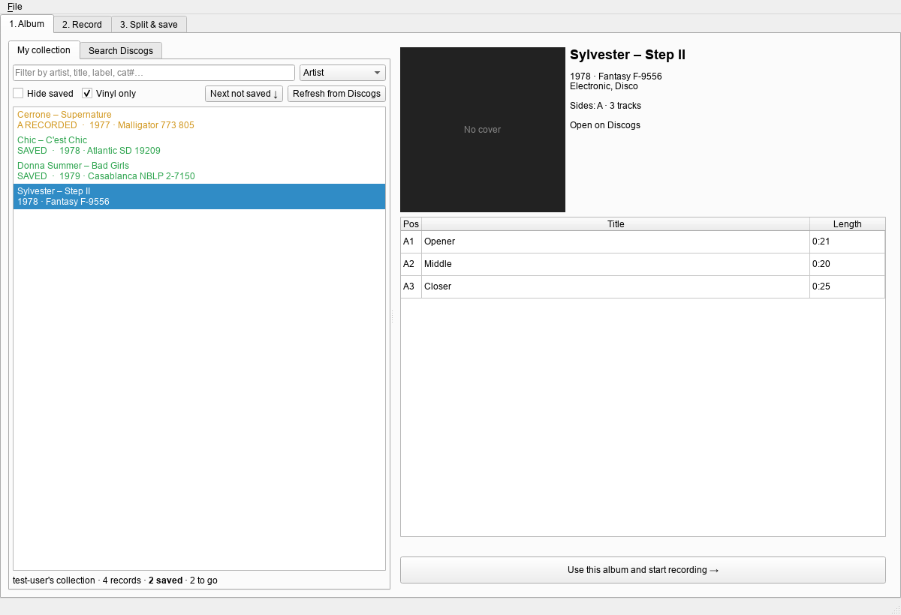
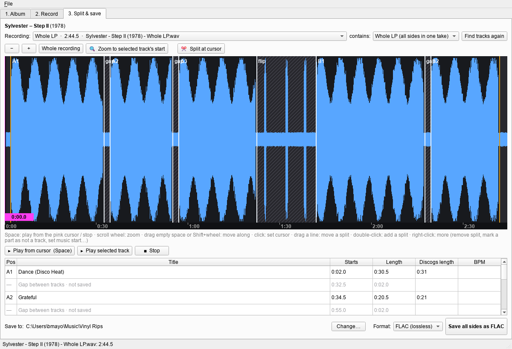
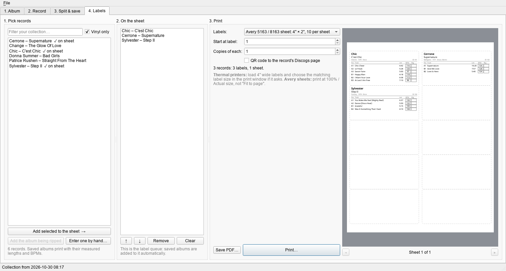

# Vinyl Recorder

Record your records, look them up in your Discogs collection, split them into tracks and save
tagged FLAC/MP3 files with cover art, BPM and length. No bells and whistles.

Windows 10/11 and macOS 11+.



## Download

Grab the zip for your computer from the **[Releases](../../releases)** page:

| Computer | File |
|---|---|
| Windows 10 / 11 | `Vinyl-Recorder-windows.zip` |
| Mac with Apple Silicon (M1 or later) | `Vinyl-Recorder-mac-apple-silicon.zip` |
| Mac with an Intel chip | `Vinyl-Recorder-mac-intel.zip` |

**Windows:** unzip it somewhere it can stay (e.g. Documents) and run `Vinyl Recorder.exe`.
If Windows says *"Windows protected your PC"*, click **More info → Run anyway** (the app isn't
signed with a paid Microsoft certificate). It then offers to add itself to the Start menu.

**Mac:** unzip it and drag **Vinyl Recorder** into Applications. The first time, macOS will
refuse to open it because it isn't from an identified developer. Open **System Settings → Privacy &
Security**, scroll down and click **Open Anyway** (on older macOS: right-click the app → Open).
When it asks to use the microphone, click **OK**. That's how it records your audio interface.

## What it does

1. **Album**: your Discogs collection as a list to work down. Already-saved records are
   green, half-done ones orange, and **Next not saved ↓** jumps to the next one to rip.
   Search Discogs for anything that isn't in your collection.
2. **Record**: pick your audio interface and inputs, set levels with the meters and clip
   counter, and press Record. **Hands-free** (on by default) waits for the needle to drop,
   pauses when you lift the needle at the end of a side (or after 20 s of run-out groove, with
   a beep to tell you to flip), carries on when the needle drops on the next side, and stops by
   itself after the last side. Long gaps and quiet intros keep recording. **Whole
   LP** records every side in one take; double LPs can be recorded a disc at a time. A **hum
   warning** tells you if the turntable's ground wire needs connecting.
3. **Split & save**: tracks are found automatically using the Discogs track lengths. Each
   track starts on its first beat and keeps its full fade-out, and needle drops, lead-in
   rumble, crackle and run-out groove are left out. Zoom in with the scroll wheel to check, drag
   lines to adjust, and press Space to play or stop. Save as FLAC, MP3 320, WAV or AIFF
   (16-bit / 44.1 kHz, which every CDJ plays), or FLAC + MP3, tagged with title, artists, album, year, label, catalogue number, cover art, length, BPM and
   ReplayGain loudness. Tick **Normalize volume** to bring each album's loudest moment to -1 dB
   (a pure volume change, nothing else). File and folder names follow a pattern you can change
   in Settings. **Save and start next album** saves in the background and takes you straight to
   the next record, so you can pick it, check levels and start recording while it saves.
4. **Labels**: print sleeve labels with the tracklist, lengths and BPMs on Avery sheets or a
   thermal label printer, for the records you've saved or any record in your collection.

### Rekordbox

Every saved album is added to `rekordbox.xml` in your save folder as a playlist (in a
"Vinyl Recorder" folder), with BPM, artist, album, label, genre, year and length. **File → Add
all saved albums to Rekordbox** adds the ones you saved before. In Rekordbox: **Preferences →
Advanced → Database → rekordbox xml → Imported Library**, and choose the file once. The albums
then appear under *rekordbox xml* in the sidebar: right-click to import. Rekordbox works out the
key itself when it analyses them.



### Labels for your sleeves

**Print labels…** (on the Split & save tab, the Album tab, or straight after saving) makes a label
with the artist, title, label · year · styles and the Discogs ID, plus a track table with the
**measured lengths and BPMs** and an empty rating box to write in. Tracklists longer than six
tracks carry on onto a second label. It prints to any printer through the normal print window,
or saves a PDF.

| Template | For |
|---|---|
| Avery 5163 / 8163: 4" × 2", 10 per letter sheet | laser / inkjet |
| Avery 5164 / 8164: 4" × 3⅓", 6 per letter sheet | laser / inkjet |
| Thermal roll 4" × 2" | Zebra, Rollo, Munbyn, Dymo 4XL… (black only) |
| Thermal roll 4" × 3" | the same |

The **4. Labels** tab makes labels on their own, no recording needed: pick records from your
Discogs collection (several at once), add the album you're ripping or type one in by hand, arrange
them on the sheet, flip through the sheets in the preview, and print. Every saved album is also
added to that sheet (the label queue) automatically, so a whole sheet of different records
prints at once. LPs are left out (DJs rarely play them out): untick **Hide LPs** to label them
too. On sheets, **Start at label** uses up a partly used sheet. Tick **QR code** for a small code linking to the record's Discogs page. Print
at 100% / Actual size. For thermal printers, set the label size in the printer's driver. If the
label comes out sideways, tick **Turn 90°**. The layout comes from the Discogs Label Maker app.



### When the record doesn't match Discogs

- **Played side B first?** Set **played: B → A** next to the recording on the Split & save tab.
- **A part got the wrong track?** Pick the right one from the dropdown in its **Title** cell. The
  parts after it follow on in order, wrapping round to the tracks not used yet. **Undo track picks**
  puts everything back.
- **Discogs is wrong** (e.g. it lists A / B1 / B2 but the record is A1 / A2 / B1)? Click **Edit
  tracklist…** and fix positions, titles, artists and lengths, or add and remove tracks. The tracks
  are then found again using your version, and it's remembered for that record.
- **Not on Discogs at all** (white labels, promos)? **Search Discogs → Not on Discogs? Enter it
  yourself…**

### First run

- **Discogs**: get a free personal access token at discogs.com → Settings → Developers →
  *Generate new token*, and paste it into **File → Settings**. Your collection then loads.
- **Audio**: on the Record tab pick your interface and the inputs your turntable or mixer is
  plugged into. On Windows, the **ASIO** entry is best if your interface has one (install the
  maker's driver). If it won't open, close other audio apps (DJ software, DAWs) and press **Apply**.
- Set your mixer so the loudest parts peak around -6 dB and the clip counter stays at 0.
- No RIAA EQ is applied: plug in a mixer or phono preamp, not a bare turntable.

Music is saved to `Music/Vinyl Rips`. Raw recordings stay in `Music/Vinyl Rips/_recordings`
until you delete them. If the app ever crashes mid-recording, the take can still be opened with
**File → Open recording**.

## Your data

Settings, your Discogs token, the record of what you've ripped and the cached collection are
stored only on your computer:

- Windows: `%APPDATA%\VinylRecorder`
- macOS: `~/Library/Application Support/VinylRecorder`

The app only talks to Discogs (api.discogs.com and its image server) and, once a day, to GitHub
to see if there's a newer version (turn that off in **File → Settings**).

## Updates

When a new version is out, the app tells you when it starts (or use **Help → Check for
updates…**). Click **Download**, close the app and unzip the new version over the old folder (on
a Mac, drag the new app into Applications and choose **Replace**). Your settings, collection, rip
log and label queue live elsewhere and are kept.

## Running from source

Needs Python 3.11+.

- **Windows:** double-click `launch.bat` (sets up on first run, creates Start menu shortcuts).
- **macOS:** double-click `launch.command`, or run it in Terminal. macOS asks for microphone
  access for Terminal the first time you record.

To make the shortcuts again, or remove them, on Windows:

```
.venv\Scripts\python.exe tools\install_shortcuts.py
.venv\Scripts\python.exe tools\install_shortcuts.py --remove
```

## Building the apps

GitHub Actions ([.github/workflows/build.yml](.github/workflows/build.yml)) tests and builds
all three downloads on every push to `main`. Pushing a version tag publishes them as a release:

```
git tag v1.0.0
git push origin v1.0.0
```

To build locally, run `packaging\build.bat` on Windows or `packaging/build_mac.sh` on a Mac.
The result can be checked with `"Vinyl Recorder.exe" --self-test report.txt` (or
`"Vinyl Recorder.app/Contents/MacOS/Vinyl Recorder" --self-test report.txt`).

## Development

```
python -m pytest tests                          # unit tests (no audio hardware needed)
python tests/smoke_ui.py <out_dir>              # drives the real window offscreen, saves screenshots
python tools/make_icon.py                       # redraws the icons (needs Pillow for the Mac one)
```

| Module | What it does |
|---|---|
| `vinyl/audio.py` | recording, playback, level analysis (all PortAudio calls on one thread) |
| `vinyl/splitter.py` | finds gaps, record flips, first beats and fade-outs |
| `vinyl/tempo.py` | BPM detection |
| `vinyl/discogs.py` | Discogs search, releases and collection |
| `vinyl/export.py` | cutting tracks, FLAC/MP3 writing and tagging |
| `vinyl/naming.py` | file and folder name patterns |
| `vinyl/loudness.py` | loudness (BS.1770), ReplayGain and normalizing |
| `vinyl/hum.py` | ground-hum detection |
| `vinyl/tracklist.py` | matching parts to tracks (side order, your track picks) |
| `vinyl/labels.py` | label templates, layout, printing and PDF |
| `vinyl/rekordbox.py` | the Rekordbox XML library |
| `vinyl/updates.py` | checking GitHub for a newer release |
| `vinyl/library.py` | the local rip log, collection cache, tracklist corrections and label queue |
| `vinyl/ui/` | the window |

## License

MIT, see [LICENSE](LICENSE).
